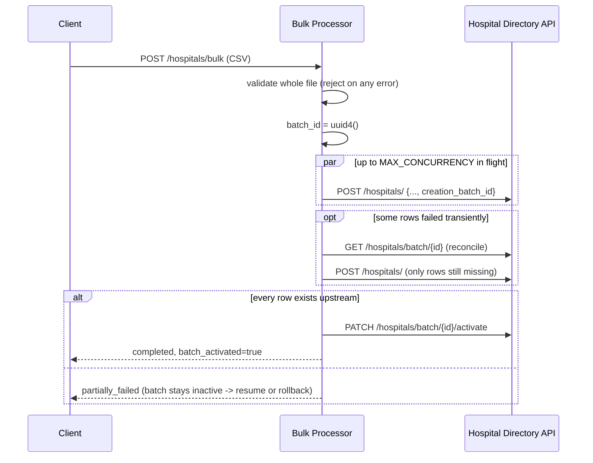

# Hospital Bulk Processor

A FastAPI service that imports hospitals from a CSV into the
[Hospital Directory API](https://hospital-directory.onrender.com/docs). Each upload becomes
one **batch**. Hospitals are created inactive under the batch ID, and the batch is
activated only after every row exists upstream exactly once.

- **Live:** `https://<your-service>.onrender.com/docs` *(replace after deploying, see [Deployment](#deployment))*
- **Stack:** Python 3.12, FastAPI, httpx (async), Pydantic v2, Docker, Render

---

## Quick start

```bash
# Docker
docker compose up --build              # -> http://localhost:8000/docs

# or locally
make install && make run               # -> http://localhost:8000/docs
```

```bash
curl -F "file=@samples/hospitals_valid.csv" http://localhost:8000/hospitals/bulk
```

```json
{
  "batch_id": "1bb0db00-545b-4847-8259-17d2506f8bb1",
  "status": "completed",
  "total_hospitals": 20,
  "processed_hospitals": 20,
  "failed_hospitals": 0,
  "processing_time_seconds": 5.85,
  "batch_activated": true,
  "progress": { "total": 20, "completed": 20, "succeeded": 20, "failed": 0, "percent": 100.0 },
  "error": null,
  "hospitals": [
    { "row": 1, "hospital_id": 1935, "name": "City General Hospital", "status": "created_and_activated", "error": null }
  ]
}
```

The response is a superset of the one in the brief. `status`, `progress` and `error` are
additions, and per-row `error` is set when a row fails.

---

## API

| Method | Path | Purpose |
|---|---|---|
| `POST` | `/hospitals/bulk` | Upload a CSV and import it. `?mode=sync` (default) waits for the result. `?mode=async` returns `202` + `Location` immediately |
| `POST` | `/hospitals/bulk/validate` | Validate a CSV without creating anything (errors + warnings, per row) |
| `GET` | `/hospitals/bulk/{batch_id}` | Status and progress (polling) |
| `WS` | `/hospitals/bulk/{batch_id}/ws` | Push progress: `snapshot` → `started` / `row_updated`… → `finished` |
| `POST` | `/hospitals/bulk/{batch_id}/resume` | Retry a failed or partial batch, then activate it |
| `DELETE` | `/hospitals/bulk/{batch_id}` | Roll back: delete the batch's hospitals upstream |
| `GET` | `/health` | Liveness (used by Docker and Render health checks) |

**CSV:** header `name,address,phone`. `phone` is optional, and the column may be omitted.
At most 20 rows and 1 MB. UTF-8, with or without a BOM. Header names are case-insensitive.
Blank lines are ignored.

| Status | When |
|---|---|
| `200` | Processed (inspect `status`: `completed`, `partially_failed`, …) |
| `202` | Accepted in async mode |
| `404` | Unknown batch |
| `409` | Resume/rollback not allowed in the batch's current state (e.g. already running) |
| `413` / `415` | File too large / not a `.csv` |
| `422` | CSV invalid. Body lists every error by row and field, and **nothing is created** |
| `502` | Hospital Directory API failed on a synchronous call (rollback) |

Examples:

```bash
# async + poll
curl -i -F "file=@samples/hospitals_valid.csv" "http://localhost:8000/hospitals/bulk?mode=async"
curl http://localhost:8000/hospitals/bulk/<batch_id>

# live progress
websocat ws://localhost:8000/hospitals/bulk/<batch_id>/ws

# validation report
curl -F "file=@samples/hospitals_invalid.csv" http://localhost:8000/hospitals/bulk/validate
```

---

## How it works



```
app/
├── api/            HTTP layer: routes, dependencies, upload handling, error mapping
├── clients/        HospitalDirectoryClient: pooled httpx, retry rules, typed responses
├── services/       BulkHospitalService (orchestration), CSV parser, progress broker
├── domain/         BatchJob / RowResult state machine (framework-free dataclasses)
├── repositories/   JobRepository protocol + bounded in-memory implementation
├── schemas/        Pydantic response models (API contract, separate from domain)
├── core/           config-free building blocks: retry policy, task registry, errors
├── config.py       env-driven Settings
└── main.py         app factory + lifespan (wires everything once per process)
```

Dependencies point inward: `api → services → clients/repositories → domain`. The domain
has no FastAPI or httpx imports, and the service only depends on the `JobRepository`
protocol. Swapping in Redis is a new class, not a rewrite.

---

## Design decisions

### 1. Activation as a commit point
The upstream's batch model works as a cheap two-phase commit. Rows are written inactive,
and one `PATCH …/activate` publishes them all. If anything goes wrong, the batch stays
inactive, so readers of the directory never see half an import. On failure I keep the
batch for **resume** and do not auto-delete it. The client can still roll it back
explicitly.

### 2. `POST /hospitals/` is not idempotent, so retries depend on what failed
Blindly retrying a create that timed out is how duplicates happen. The client asks one
question per failure: *could the request have been applied?*

| Failure | Retried in the HTTP client? |
|---|---|
| Connect error / pool timeout (never sent), `429`, `503` (refused) | Yes, for every call. Exponential backoff with full jitter, honours `Retry-After` |
| Read timeout, `500`/`502`/`504` (outcome unknown) | Only idempotent calls (`GET`, `PATCH activate`, `DELETE`) |
| Other `4xx` | Never (permanent) |

An ambiguous create failure goes back to the service. It **reconciles** before retrying.
It lists `GET /hospitals/batch/{id}`, *adopts* records that match a row we thought had
failed (same name/address/phone), and deletes records that no row accounts for. Then it
re-creates only the rows that are truly missing. If anything was retried, it reconciles
once more just before activation. That way a late-landing timed-out request can't sneak
a duplicate into the activated batch. Deleting is safe because the batch ID is a UUID
this service generated.

> Residual risk: a request that lands upstream *after* the final verification. Closing that
> fully needs an idempotency key on the upstream `POST`, which the given API doesn't offer.

### 3. Validate the whole file before touching the upstream
Rejecting a bad file costs nothing. A half-imported file costs a rollback. The parser is
pure (bytes in, records + issues out), so `/validate` and `/bulk` share it exactly. Errors
block the import. Oddities (unknown columns, odd phone formats, duplicate rows) are
**warnings**, because the upstream accepts them and the user may intend them.

### 4. Sync by default, async when asked
The brief's response is the final result, so `sync` is the default. Sync processing runs
as an owned background task behind `asyncio.shield`. If the HTTP client disconnects
mid-import, the batch still finishes and stays queryable, so a dropped connection never
leaves a half-written batch. `?mode=async` returns `202` with a `Location` header for
polling or the WebSocket.

### 5. Progress that is cheap and can't drift
The service publishes event *types* to an in-process broker. Each WebSocket frame carries
the job's **current full state**, not a delta. Subscriber queues are bounded and drop the
oldest event when full, so a slow client can't stall processing and can't show wrong
totals. The socket subscribes *before* sending the snapshot, so no event can fall between
the two. The last frame is always `finished`.

### 6. Resume and rollback are state-machine transitions
`pending → processing → completed | partially_failed | activation_failed | failed`, and
from any finished state `→ rolled_back`. Resume is allowed only from the three failure
states. The check-and-claim has no `await` in between, so it is atomic on the event loop,
and two concurrent resumes cannot both run (`409`). Resume reconciles first, so a previous
run's ambiguous failures never turn into duplicates.

---

## Performance

The upstream's create latency dominates: **~5.3 s per `POST /hospitals/`**, measured. The
service's own overhead is negligible next to it. So throughput comes from concurrency,
bounded so we never overwhelm the upstream.

Measured against the live Hospital Directory API, 20-row CSV, end-to-end through the service
(`python -m scripts.benchmark samples/hospitals_valid.csv --concurrency 1 5 10 20`):

| `MAX_CONCURRENCY` | Wall time | Speed-up |
|---:|---:|---:|
| 1 (sequential) | 106.6 s | 1× |
| 5 | 21.7 s | 4.9× |
| 10 | 11.2 s | 9.5× |
| **20 (default)** | **5.9 s** | **18×** |

What makes that possible:
- **One pooled `httpx.AsyncClient` per process.** Keep-alive connections are reused across
  rows and batches, with no TLS handshake per hospital.
- **One semaphore shared by all jobs.** Ten simultaneous uploads still put at most
  `MAX_CONCURRENCY` requests on the upstream, rather than 10 × 20.
- **Retries never hold a concurrency slot while sleeping.** Jittered backoff avoids retry
  storms when a burst of requests fails together.
- **Validation is O(rows) in memory.** The upload is read with a hard byte cap, so it is
  never buffered beyond 1 MB.
- **The happy path makes exactly N + 1 upstream calls** (N creates + 1 activate).
  Reconciliation runs only when something failed.
- **Bounded memory.** The job store evicts the oldest finished jobs past `JOB_STORE_MAX_JOBS`.

### Scaling beyond one instance
Job state is in process memory (allowed by the brief). That is why the container runs
exactly **one** uvicorn worker. A single async worker handles many concurrent batches,
because the work is I/O-bound. To scale horizontally:
1. Implement `JobRepository` on Redis or Postgres. The service already calls `save()` at
   every transition.
2. Move execution from `BackgroundTaskRegistry` to a queue (arq / Celery / SQS workers),
   and make the API publish jobs.
3. Replace `ProgressBroker` with Redis pub/sub so any API node can serve any WebSocket.
4. Move the concurrency limit to a distributed rate limiter, so the upstream budget holds
   across nodes.

---

## Configuration

All settings are environment variables. See `app/config.py` and `.env.example`.

| Variable | Default | Notes |
|---|---|---|
| `HOSPITAL_API_BASE_URL` | `https://hospital-directory.onrender.com` | |
| `MAX_CONCURRENCY` | `20` | In-flight upstream calls, process-wide |
| `MAX_CSV_ROWS` | `20` | Per brief |
| `MAX_UPLOAD_BYTES` | `1048576` | |
| `MAX_RETRIES` | `3` | HTTP attempts per call (when safe) |
| `RETRY_BACKOFF_BASE_SECONDS` / `RETRY_BACKOFF_MAX_SECONDS` | `0.5` / `8` | Full-jitter exponential |
| `AUTO_RETRY_PASSES` | `1` | Reconcile-and-retry passes before giving up |
| `HTTP_CONNECT_TIMEOUT_SECONDS` / `HTTP_READ_TIMEOUT_SECONDS` | `10` / `60` | Read is generous: upstream cold starts on Render take ~50 s |
| `JOB_STORE_MAX_JOBS` | `1000` | |
| `SHUTDOWN_GRACE_SECONDS` | `30` | In-flight batches are drained on shutdown |
| `LOG_LEVEL` | `INFO` | |

---

## Deployment

### Render (Blueprint, uses `render.yaml`)
1. Push this repository to GitHub, GitLab or Bitbucket.
2. In Render: **New → Blueprint**, connect the repository, then **Apply**.
   Render builds the `Dockerfile`, injects `PORT`, and health-checks `/health`.
3. Open `https://<service-name>.onrender.com/docs`.

Manual alternative: **New → Web Service → Docker**, health check path `/health`, with no
other settings needed.

Notes:
- The free plan sleeps after ~15 min idle, and the first request then takes ~30–50 s.
  The upstream does the same, which is why the read timeout is 60 s.
- Restarts and deploys clear in-memory jobs. Batches already *activated* upstream are unaffected.

### Docker anywhere
```bash
docker build -t hospital-bulk-processor .
docker run -p 8000:8000 -e MAX_CONCURRENCY=20 hospital-bulk-processor
```
The image is `python:3.12-slim`. It runs as a non-root user, has a `HEALTHCHECK`, and
reads `PORT` from the environment. uvicorn runs with `--proxy-headers`, so the `Location`
URLs are `https` behind a load balancer.

---

## Development

```bash
make install     # venv + deps
make run         # uvicorn --reload on :8000
make lint        # ruff check + format check
make typecheck   # mypy --strict
```

`samples/` has a valid 20-row CSV and an invalid one that triggers every validation rule.

## What I'd do next
- An idempotency key on upstream creates (needs an API change) to close the last duplicate window.
- Persistent job store plus a queue worker (see *Scaling*), so jobs survive restarts.
- Prometheus metrics: upstream latency histogram, retries by cause, batch outcome counts.
- Auth and per-client rate limits on the bulk endpoint.
